<div align="center">

# StockWise

**Sistema de Apoio à Decisão para Definição de Estratégias Promocionais Baseado no Custo Gerencial de Estoque em Autopeças**


[](https://sonarcloud.io/project/overview?id=weillerjulia_StockWise)
[](https://sonarcloud.io/project/overview?id=weillerjulia_StockWise)

</div>

---

## Índice

1. [Introdução](#1-introdução)
2. [Escopo e limitações](#2-escopo-e-limitações)
3. [Funcionalidades e diferencial](#3-funcionalidades-e-diferencial)
4. [Vídeo da aplicação](#4-vídeo-da-aplicação)
5. [Requisitos](#5-requisitos)
6. [Casos de uso](#6-casos-de-uso)
7. [Fluxos de negócio](#7-fluxos-de-negócio)
8. [Estrutura de navegação](#8-estrutura-de-navegação)
9. [Arquitetura](#9-arquitetura)
10. [Stack tecnológica](#10-stack-tecnológica)
11. [Documentação da API](#11-documentação-da-api)
12. [Decisões técnicas e trade-offs](#12-decisões-técnicas-e-trade-offs)
13. [Qualidade, testes e privacidade](#13-qualidade-testes-e-privacidade)
14. [Resultados e validação](#14-resultados-e-validação)
15. [Aderência à linha Web](#15-aderência-à-linha-web)
16. [Trabalhos futuros](#16-trabalhos-futuros)
17. [Como rodar o projeto](#17-como-rodar-o-projeto)
18. [Referências](#18-referências)
19. [Autora](#19-autora)

---

## 1. Introdução

### Contexto

Empresas do setor de autopeças trabalham com milhares de itens, de giro muito
diferente entre si. Os ERPs usados por essas empresas registram entradas,
saídas e quantidades em estoque, mas tratam o custo do produto como o custo de
aquisição. Não consideram quanto custa manter uma peça parada na prateleira por
meses: armazenagem e capital que poderia estar rendendo em outro lugar.

### Problema de pesquisa

> Como transformar os dados que o ERP já registra em uma recomendação de
> desconto promocional que seja financeiramente segura para cada produto?

Na prática, o gestor não tem resposta para perguntas como:

- *Qual é o custo real de manter este produto parado?*
- *Qual o desconto máximo que posso aplicar sem prejuízo?*
- *Quais produtos devo priorizar numa campanha promocional?*

### Público beneficiado

Donos e gestores de estoque de lojas e distribuidoras de autopeças, que decidem
preços e promoções e já usam um ERP, mas não têm uma ferramenta de análise
financeira do estoque.

### Justificativa

Estoque parado é capital imobilizado. Sem saber o custo real de cada produto, o
gestor ou deixa de fazer promoções que liberariam esse capital, ou dá descontos
no escuro, correndo o risco de vender abaixo do custo. Uma camada analítica
sobre os dados que a empresa já tem resolve isso sem trocar o ERP.

### Objetivos

**Objetivo geral:** desenvolver um sistema web que calcule o custo gerencial
composto de cada produto e, a partir dele, sugira o desconto máximo aplicável
sem prejuízo.

**Objetivos específicos:**

- Importar o estoque exportado do ERP em CSV, validando cada linha.
- Calcular o custo gerencial composto (aquisição + armazenagem + custo de
  oportunidade, proporcionais ao tempo em estoque).
- Calcular o giro de estoque em três janelas (30, 90 e 180 dias).
- Classificar os produtos em Prioridade Alta, Média ou Baixa.
- Sugerir o desconto máximo por produto, preservando uma margem mínima.
- Apresentar os resultados em dashboard e tabela, com explicação de cada métrica.
- Validar a classificação por regras com um método não supervisionado (K-Means).

---

## 2. Escopo e limitações

**Dentro do escopo**

- Importação manual de CSV exportado do ERP.
- Cálculo de custo gerencial, giro, classificação e desconto máximo.
- Dashboard, tabela de produtos com exportação e página de ajuda.
- Análise exploratória com K-Means para validar a classificação.

**Fora do escopo (decisões conscientes)**

- **Integração direta com o ERP:** depende de exportação manual do CSV.
- **Login e usuários:** o sistema é aberto, sem cadastro nem perfis.
- **Hospedagem pública:** o sistema roda localmente, conforme acordado com a
  orientação.

**Limitações conhecidas**

- O frontend mostra apenas a última importação feita **no mesmo navegador**
  (o `id` fica no `localStorage`).
- A gravação da importação não é atômica: uma falha no meio mantém as linhas já
  gravadas.
- O gráfico de categorias e a distribuição por prioridade do Dashboard usam
  o valor **por unidade**; só os indicadores "em estoque" multiplicam pela
  quantidade em estoque.
- A data de referência dos cálculos é o dia do upload, e não o dia em que o CSV
  foi extraído do ERP.
- A classificação é relativa ao lote: um produto pode mudar de faixa se os
  outros produtos do arquivo mudarem.

A lista completa está na [RFC, seção 6](docs/RFC.md#6-limitações-conhecidas-do-poc).

---

## 3. Funcionalidades e diferencial

### Diferencial: custo gerencial composto

Enquanto o ERP registra só o custo de aquisição, o StockWise soma a ele o custo
de armazenagem e o custo de oportunidade do capital, proporcionais aos dias em
estoque. Com esse indicador, o sistema vai além de apontar produtos parados:
calcula quanto cada um realmente custa e qual o maior desconto possível sem
prejuízo.

```
custo gerencial = custo de aquisição
                + custo de aquisição × armazenagem % ao mês × (dias ÷ 30)
                + custo de aquisição × custo de oportunidade % ao ano × (dias ÷ 365)

preço mínimo    = custo gerencial × 1,10        (margem mínima de 10%)
desconto máximo = preço de venda − preço mínimo
```

**Exemplo:** preço de venda R$ 34,90 e custo gerencial R$ 22,69 → preço mínimo
R$ 24,96 → desconto máximo de **R$ 9,94 (28,48%)**.

### Funcionalidades

A lista completa de funcionalidades está nos [requisitos funcionais](#requisitos-funcionais).

> As telas foram demonstradas no vídeo abaixo. 

---

## 4. Vídeo da aplicação

> **[A inserir]** Link do vídeo de demonstração.

---

## 5. Requisitos

### Requisitos funcionais

| ID | Requisito | Caso de uso |
|---|---|---|
| RF01 | Importar o estoque a partir de um CSV exportado do ERP. | UC01 |
| RF02 | Detectar automaticamente a codificação, o delimitador e o formato monetário do CSV, recusando valores ambíguos. | UC01 |
| RF03 | Validar cada linha e listar os erros (número da linha e mensagem) sem interromper a importação das linhas válidas. | UC01 |
| RF04 | Calcular o custo gerencial composto de cada produto. | UC01, UC03 |
| RF05 | Calcular o giro de estoque anualizado em 30, 90 e 180 dias. | UC01, UC03 |
| RF06 | Classificar cada produto em Prioridade Alta, Média ou Baixa, relativa ao lote importado. | UC01, UC03 |
| RF07 | Calcular o desconto máximo sugerido (em % e R$) que preserva a margem mínima e sinalizar produtos sem espaço para desconto. | UC04 |
| RF08 | Exibir o resumo da última importação (data, linhas importadas, linhas com erro e status). | UC02 |
| RF09 | Exibir indicadores agregados (por unidade e em estoque), gráficos e mapa de prioridade no Dashboard, com atalhos para a tabela de Produtos já filtrada. | UC06 |
| RF10 | Listar os produtos com busca, filtro por classificação, ordenação por qualquer coluna e paginação. | UC03 |
| RF11 | Exportar a lista filtrada de produtos para CSV compatível com Excel. | UC05 |
| RF12 | Explicar cada métrica na interface (tooltips) e na página de Ajuda, com fórmulas e exemplos. | UC07 |

### Requisitos não funcionais

| ID | Requisito | Como é atendido |
|---|---|---|
| RNF01 | **Segurança:** o navegador nunca acessa o banco diretamente. | Só a API tem a chave do Supabase, lida do `.env`. |
| RNF02 | **Precisão:** cálculos monetários sem erro de arredondamento binário. | Uso de `Decimal` no backend e de centavos inteiros no frontend. |
| RNF03 | **Testabilidade:** cobertura mínima de 75% no backend e 25% no frontend. | Regras de negócio em funções puras; o CI falha abaixo da meta. |
| RNF04 | **Usabilidade:** interface em português, com valores e datas no formato brasileiro. | Formatação pt-BR em toda a interface e no CSV exportado. |
| RNF05 | **Acessibilidade:** informação não depende só de cor. | Classificação por cor **e** formato (▲ ◆ ●) no mapa, nas pílulas e nas legendas; tooltips e paginação acessíveis por teclado e leitor de tela. |
| RNF06 | **Robustez:** linhas inválidas não derrubam a importação. | Validação linha a linha, com erro registrado por linha. |
| RNF07 | **Compatibilidade:** o CSV exportado abre corretamente no Excel. | Delimitador `;` e codificação UTF-8 com BOM. |
| RNF08 | **Manutenibilidade:** código modular e analisado continuamente. | Separação em rotas, serviços e repositório; análise do SonarQube Cloud a cada push. |

---

## 6. Casos de uso

Ator único: **Gestor** (dono ou gestor de estoque da autopeças). O sistema é
aberto, sem login nem perfis.

<p align="center">
  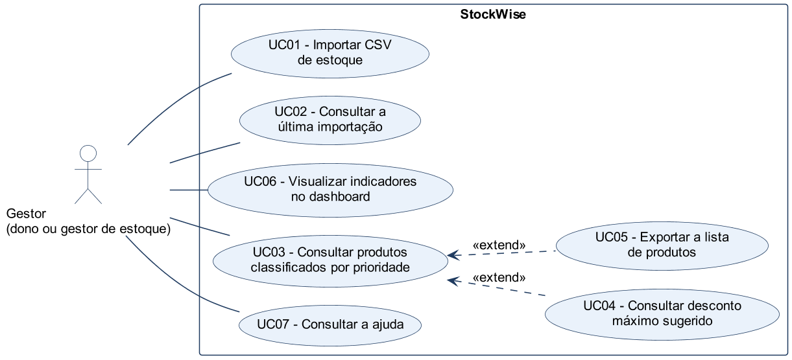
</p>

Fluxos principais e alternativos de cada caso: [docs/casos-de-uso.md](docs/casos-de-uso.md).
Fonte do diagrama: [docs/diagramas/casos-de-uso.puml](docs/diagramas/casos-de-uso.puml).

---

## 7. Fluxos de negócio

Os três fluxos completos do sistema, do ponto de vista do gestor. Cada um
cruza frontend, API e banco.

### Fluxo 1: Importar o estoque do ERP (UC01, UC02)

```mermaid
%%{init: {"themeVariables": {"fontSize": "13px"}, "flowchart": {"wrappingWidth": 400, "rankSpacing": 28, "nodeSpacing": 30, "padding": 8}}}%%
flowchart TD
    inicio(( )) --> a1["Gestor exporta o CSV do ERP e o envia na tela Upload<br/><i>POST /importacoes</i>"]
    a1 --> a2["API decodifica o arquivo e detecta o delimitador"]
    a2 --> a3["Valida a próxima linha<br/><i>campos obrigatórios, datas, valores</i>"]
    a3 --> d1{"Linha válida?"}
    d1 -- Não --> a4["Registra o erro com o número da linha"]
    d1 -- Sim --> d2{"Há mais linhas?"}
    a4 --> d2
    d2 -- Sim --> a3
    d2 -- Não --> a5["Calcula custo gerencial, giro, classificação<br/>do lote e desconto máximo"]
    a5 --> a6["Grava produtos, snapshots e resultados no banco"]
    a6 --> d3{"Gravou sem falha?"}
    d3 -- Não --> a7["Tela exibe a mensagem de erro"]
    d3 -- Sim --> a8["Finaliza a importação, salva o id e exibe<br/>o resumo com os erros por linha"]
    a7 --> fim((( )))
    a8 --> fim

    classDef marco fill:#1E3A5F,stroke:#1E3A5F
    classDef decisao fill:#FFF4D6,stroke:#B8860B,color:#3A2A00
    classDef acao fill:#EAF2FB,stroke:#1E3A5F,color:#0B2540
    classDef erro fill:#FDECEC,stroke:#B42318,color:#5A0E0A
    class inicio,fim marco
    class d1,d2,d3 decisao
    class a1,a2,a3,a5,a6,a8 acao
    class a4,a7 erro
```

### Fluxo 2: Analisar o estoque na Visão geral (UC06, UC07)

```mermaid
%%{init: {"themeVariables": {"fontSize": "13px"}, "flowchart": {"wrappingWidth": 400, "rankSpacing": 28, "nodeSpacing": 30, "padding": 8}}}%%
flowchart TD
    inicio(( )) --> b1["Gestor abre a tela Visão geral"]
    b1 --> d1{"Há importação salva<br/>neste navegador?"}
    d1 -- Não --> b2["Exibe Nenhuma importação encontrada<br/>com link para a tela Upload"]
    d1 -- Sim --> b3["Frontend busca<br/>GET /importacoes/{id}/resultados"]
    b3 --> d2{"A API respondeu?"}
    d2 -- Não --> b4["Exibe a mensagem de erro"]
    d2 -- Sim --> b5["Calcula os indicadores no navegador e exibe resumo,<br/>7 indicadores (por unidade e em estoque), gráficos e mapa de prioridade"]
    b5 --> b6["Gestor analisa o quadrante Parado e caro<br/>e as listas de maior custo e mais tempo parado"]
    b6 --> d3{"Dúvida sobre<br/>um indicador?"}
    d3 -- Sim --> b7["Consulta o tooltip ou a tela Ajuda"]
    d3 -- Não --> b8["Define quais produtos merecem atenção"]
    b7 --> b8
    b8 --> d4{"Quer ver os produtos<br/>na tabela?"}
    d4 -- Sim --> b9["Clica numa prioridade, em Ver produtos prioritários<br/>ou num item do Top 5 e abre Produtos já filtrado"]
    d4 -- Não --> fim((( )))
    b9 --> fim
    b2 --> fim
    b4 --> fim

    classDef marco fill:#1E3A5F,stroke:#1E3A5F
    classDef decisao fill:#FFF4D6,stroke:#B8860B,color:#3A2A00
    classDef acao fill:#EAF2FB,stroke:#1E3A5F,color:#0B2540
    classDef erro fill:#FDECEC,stroke:#B42318,color:#5A0E0A
    class inicio,fim marco
    class d1,d2,d3,d4 decisao
    class b1,b3,b5,b6,b7,b8,b9 acao
    class b2,b4 erro
```

### Fluxo 3: Planejar a promoção na tela Produtos (UC03, UC04, UC05)

```mermaid
%%{init: {"themeVariables": {"fontSize": "13px"}, "flowchart": {"wrappingWidth": 400, "rankSpacing": 28, "nodeSpacing": 30, "padding": 8}}}%%
flowchart TD
    inicio(( )) --> c1["Gestor abre a tela Produtos"]
    c1 --> d1{"Há importação salva<br/>neste navegador?"}
    d1 -- Não --> c2["Exibe Nenhuma importação encontrada<br/>com link para a tela Upload"]
    d1 -- Sim --> c3["Filtra por classificação, busca e ordena a tabela<br/><i>ex.: Prioridade Alta, maior desconto</i>"]
    c3 --> d2{"O produto tem<br/>preço de venda?"}
    d2 -- Não --> c4["Coluna de desconto exibe um traço"]
    d2 -- Sim --> d3{"Há espaço para<br/>desconto?"}
    d3 -- Não --> c5["Exibe o selo Prejuízo, Sem margem<br/>ou No limite: rever preço ou custo"]
    d3 -- Sim --> c6["Define o desconto da promoção<br/>dentro do máximo sugerido"]
    c4 --> d4{"Exportar a lista?"}
    c5 --> d4
    c6 --> d4
    d4 -- Sim --> c7["Clica em Exportar Excel e baixa<br/>o CSV com a lista filtrada"]
    d4 -- Não --> fim((( )))
    c2 --> fim
    c7 --> fim

    classDef marco fill:#1E3A5F,stroke:#1E3A5F
    classDef decisao fill:#FFF4D6,stroke:#B8860B,color:#3A2A00
    classDef acao fill:#EAF2FB,stroke:#1E3A5F,color:#0B2540
    classDef erro fill:#FDECEC,stroke:#B42318,color:#5A0E0A
    class inicio,fim marco
    class d1,d2,d3,d4 decisao
    class c1,c3,c6,c7 acao
    class c2,c4,c5 erro
```

---

## 8. Estrutura de navegação

SPA com 4 telas, acessadas pelo menu lateral fixo. As telas Visão geral e
Produtos levam de volta ao Upload quando ainda não há importação.

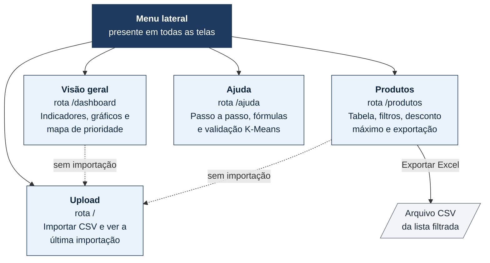

---

## 9. Arquitetura

Arquitetura **em camadas, cliente-servidor**, como definido na
[RFC](docs/RFC.md#2-arquitetura): o frontend (apresentação) só conversa com a
API (processamento), que é a única com acesso ao banco (dados).

### C4: Nível 1, Contexto

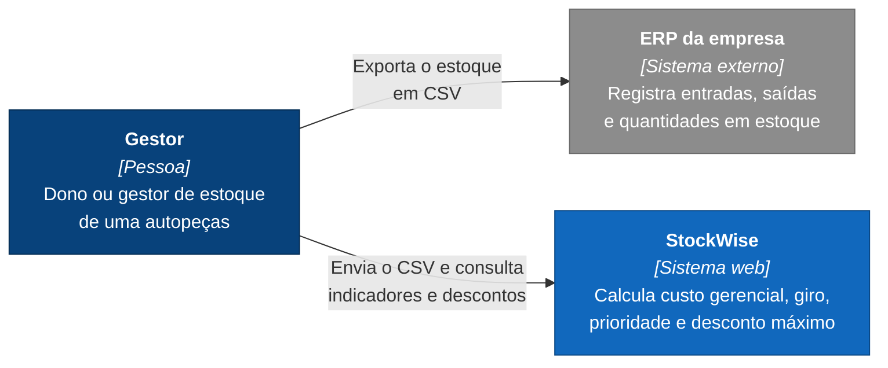

### C4: Nível 2, Contêineres

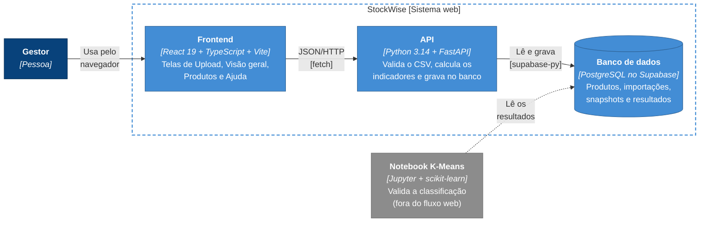

### C4: Nível 3, Componentes da API

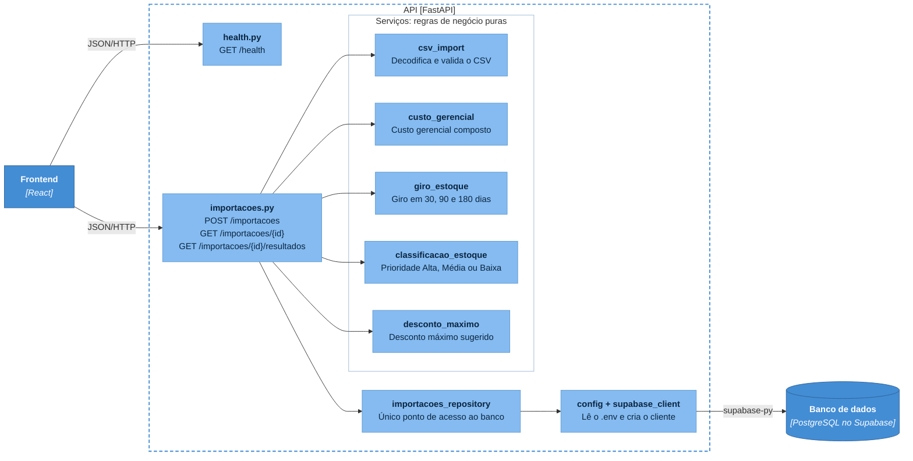

### Organização modular do código

| Camada | Pasta | Responsabilidade |
|---|---|---|
| Rotas da API | [backend/app/api/](backend/app/api/) | Recebem a requisição HTTP e orquestram os serviços. |
| Serviços | [backend/app/services/](backend/app/services/) | Regras de negócio puras, sem acesso a rede ou banco, testáveis isoladamente. |
| Repositório | [importacoes_repository.py](backend/app/services/importacoes_repository.py) | Único módulo que fala com o Supabase. |
| Páginas | [frontend/src/pages/](frontend/src/pages/) | Uma tela por rota. |
| Componentes | [frontend/src/components/](frontend/src/components/) | Reutilizáveis: `KpiCard`, `CardSecao`, `ClassificacaoBadge`, `MarcadorClassificacao`, `HelpTooltip`, `Pagination`, `MapaPrioridadeChart`, `SeloSemDesconto`, `LogoSimbolo` e o layout (`AppLayout`, `Sidebar`, `Topbar`, `ExtrasDoTitulo`). |
| Acesso à API | [frontend/src/api/](frontend/src/api/) | Funções `fetch`, tipos TypeScript e leitura do `localStorage`. |
| Hooks e utilitários | [frontend/src/hooks/](frontend/src/hooks/), [frontend/src/utils/](frontend/src/utils/) | Busca dos resultados, formatação pt-BR, exportação do CSV, situação do desconto e cores/formatos das classificações. |

### Modelagem de dados

Quatro tabelas, separando dado descritivo (`produtos`), rastreio de cada upload
(`importacoes`), dado bruto do CSV (`estoque_snapshots`) e dado calculado
(`resultados_analise`). Script: [backend/db/schema.sql](backend/db/schema.sql).

<p align="center">
  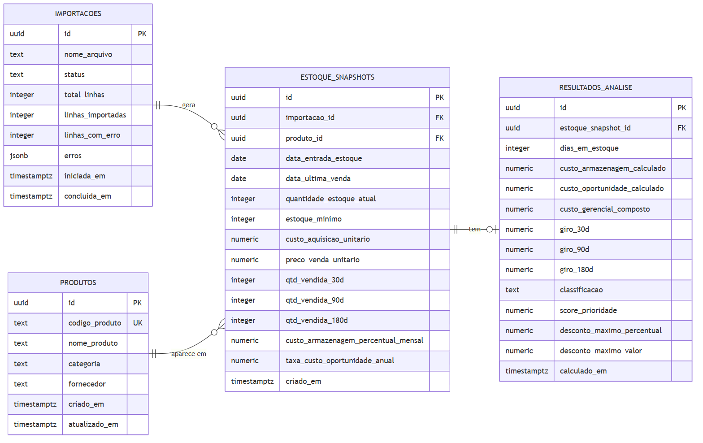
</p>

Fonte do diagrama: [docs/diagramas/modelo-dados.mmd](docs/diagramas/modelo-dados.mmd).

### Formato do CSV

A única fonte de dados é o CSV exportado do ERP da empresa. O caminho do
arquivo até o banco está no [Fluxo 1](#fluxo-1-importar-o-estoque-do-erp-uc01-uc02).
A primeira linha deve trazer o nome das colunas.

| | Colunas |
|---|---|
| **Obrigatórias** | `codigo_produto`, `nome_produto`, `data_entrada_estoque`, `quantidade_estoque_atual`, `custo_aquisicao_unitario` |
| **Opcionais** | `categoria`, `fornecedor`, `data_ultima_venda`, `estoque_minimo`, `preco_venda_unitario`, `qtd_vendida_30d`, `qtd_vendida_90d`, `qtd_vendida_180d`, `custo_armazenagem_percentual_mensal`, `taxa_custo_oportunidade_anual` |

- **Delimitador:** `;`, `,` ou tab.
- **Datas:** `dd/mm/aaaa`.
- **Valores monetários:** `R$ 1.234,56`, `1234,56` ou `1234.56`. Valores
  ambíguos ou malformados, como `1.234`, `1,234` ou `1,234.50`, geram erro na
  linha. Para mil reais, escreva `1.000,00` ou `1000.00`.
- Quantidades e percentuais vazios valem 0. Sem `preco_venda_unitario`, o
  desconto máximo não é calculado.

---

## 10. Stack tecnológica

| Camada | Tecnologias |
|---|---|
| **Frontend** | React 19, TypeScript, Vite, React Router, Tailwind CSS v4, Recharts, lucide-react |
| **Backend** | Python 3.14, FastAPI, Uvicorn, pydantic-settings, python-multipart, biblioteca padrão `csv` (sem pandas na API) |
| **Banco de dados** | PostgreSQL gerenciado pelo Supabase, acessado pelo cliente `supabase-py` |
| **Testes** | pytest, pytest-cov, httpx (backend); Vitest, Testing Library, `@vitest/coverage-v8` (frontend) |
| **Qualidade e CI** | GitHub Actions, SonarQube Cloud |
| **Análise exploratória** | Jupyter Notebook, pandas, scikit-learn (K-Means, silhouette score), matplotlib |

---

## 11. Documentação da API

O FastAPI gera a documentação interativa automaticamente. Com o backend
rodando ([seção 17](#17-como-rodar-o-projeto)):

- **Swagger UI:** <http://localhost:8000/docs>
- **ReDoc:** <http://localhost:8000/redoc>

| Método | Rota | Descrição |
|---|---|---|
| `GET` | `/health` | Healthcheck: `{"status": "ok"}`. |
| `POST` | `/importacoes` | Recebe o CSV (`multipart/form-data`, campo `arquivo`), valida, calcula e grava. Devolve o resumo da importação com os erros por linha. |
| `GET` | `/importacoes/{id}` | Metadados de uma importação (status, contagens, datas). `404` se não existir. |
| `GET` | `/importacoes/{id}/resultados` | Produtos da importação com os resultados calculados embutidos. |

Exemplos de requisição e resposta:
[DOCUMENTACAO-TECNICA.md, seção 4.1](docs/DOCUMENTACAO-TECNICA.md#41-endpoints-da-api).

---

## 12. Decisões técnicas e trade-offs

| Decisão | Por quê | Trade-off aceito |
|---|---|---|
| CSV manual em vez de integração com o ERP | Não depende de credenciais nem do protocolo de um ERP específico. | Exige uma ação manual a cada atualização. |
| 4 tabelas separando dado bruto e calculado | Mantém histórico entre importações e permite reprocessar no futuro. | Mais tabelas e joins do que uma tabela única. |
| Regras de negócio em funções puras | Cálculos testáveis sem banco, o que sustenta a cobertura de 90%. | O repositório fica com cobertura menor, porque os testes não acessam o Supabase. |
| Recusar valores monetários ambíguos | `1.234` pode ser mil ou pouco mais de um real; adivinhar distorcia custo e desconto sem aviso. | O gestor precisa corrigir essas linhas no CSV. |
| Decodificação em cadeia (UTF-8 → CP1252 → Mac Roman) | Um CSV real veio do Excel de Mac e falhava. | Um arquivo em outra codificação pode entrar com acentos incorretos. |
| Margem mínima de 10% no desconto | Evitar que a promoção mais agressiva zere a margem. O valor foi definido com o gestor da empresa (ver [seção 14](#validação-com-a-empresa)). | O desconto sugerido é mais conservador, e a margem é fixa: mudar o valor exige alterar o código. |
| `localStorage` em vez de listar importações | Suficiente para um sistema aberto de uso local. | Cada navegador vê só a última importação feita nele. |
| Busca, filtro e paginação no navegador | API mais simples, sem parâmetros de consulta. | Supõe que a importação caiba na memória do navegador. |
| K-Means em notebook separado | O objetivo era validar a classificação, não expor clusters ao usuário. | A validação não roda automaticamente a cada importação. |

### Mudanças durante o desenvolvimento

- **Pesos da classificação:** passaram de 1/3 cada para 40% / 40% / 20% depois
  da validação com K-Means (ver [seção 14](#validação-da-classificação-com-k-means)).
- **Valores monetários:** valores como `1.234` eram lidos como 1,234; passaram a
  ser recusados.
- **Usuários:** o indicador de usuário na barra superior foi removido, com a
  decisão de manter o sistema aberto.
- **Desconto:** produtos sem espaço para desconto passaram a ter selo e aviso
  na tela Produtos.
- **Indicadores em estoque:** a Visão geral passou a mostrar, além dos valores
  por unidade, o valor imobilizado, o valor crítico e o potencial de
  recuperação multiplicados pela quantidade em estoque. O giro médio virou
  giro típico (mediana), menos sensível a produtos com giro muito alto.
- **Navegação pelo painel:** a distribuição por prioridade, o botão "Ver
  produtos prioritários" e as listas Top 5 abrem a tela Produtos já filtrada
  (`/produtos?classificacao=alta`, `/produtos?busca=…`).

Todas as decisões, com o contexto completo: [docs/RFC.md](docs/RFC.md#5-decisões-técnicas-relevantes).

---

## 13. Qualidade, testes e privacidade

### Testes unitários

Backend executado em 07/11/2026 e frontend em 08/11/2026:

| Parte | Testes | Cobertura de linhas | Meta |
|---|---|---|---|
| Backend (pytest) | 35 aprovados, 0 falhas | **90%** | ≥ 75% |
| Frontend (Vitest) | 29 aprovados, 0 falhas | **83,05%** | ≥ 25% |

- **Backend:** os 4 módulos de cálculo têm 100% de cobertura, o `csv_import`
  tem 95% e as rotas, 89%. Os testes não acessam o Supabase: o repositório é
  substituído por mocks.
- **Frontend:** testes das telas Upload, Visão geral, Produtos e Ajuda, da
  paginação e do layout. Detalhes por arquivo na
  [Documentação Técnica](docs/DOCUMENTACAO-TECNICA.md#7-testes-e-qualidade).

```bash
cd backend && pytest --cov=app         # backend
cd frontend && npm run test:coverage   # frontend
```

<p align="center">
  <b>Backend</b> (coverage.py)<br/>
  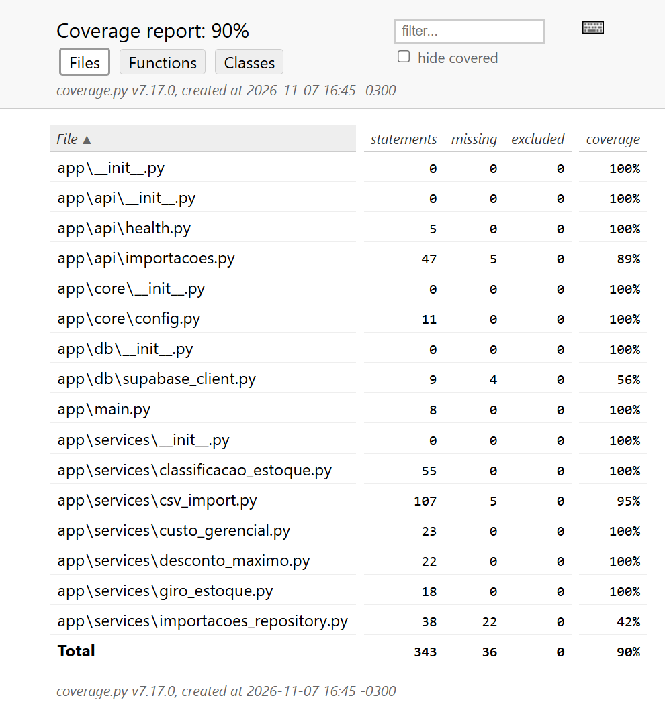
</p>

<p align="center">
  <b>Frontend</b> (Vitest + Istanbul)<br/>
  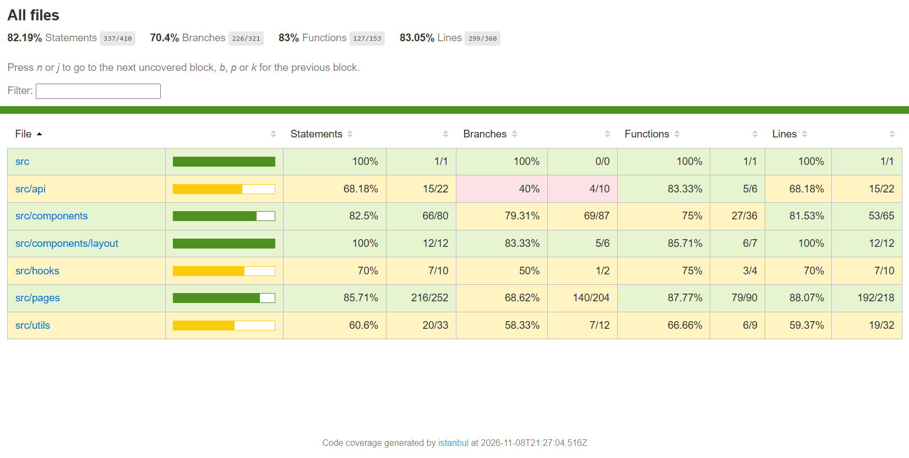
</p>

Detalhes por arquivo: [DOCUMENTACAO-TECNICA.md, seção 7](docs/DOCUMENTACAO-TECNICA.md#7-testes-e-qualidade).

### Integração contínua

O workflow [ci.yml](.github/workflows/ci.yml) roda a cada push ou pull request
para `main` e `development`:

1. **Backend:** testes e cobertura; falha abaixo de 75%.
2. **Frontend:** testes e cobertura, falha abaixo de 25% das linhas, e build.
3. **SonarQube Cloud:** envia a análise estática e os relatórios de cobertura.

<p align="center">
  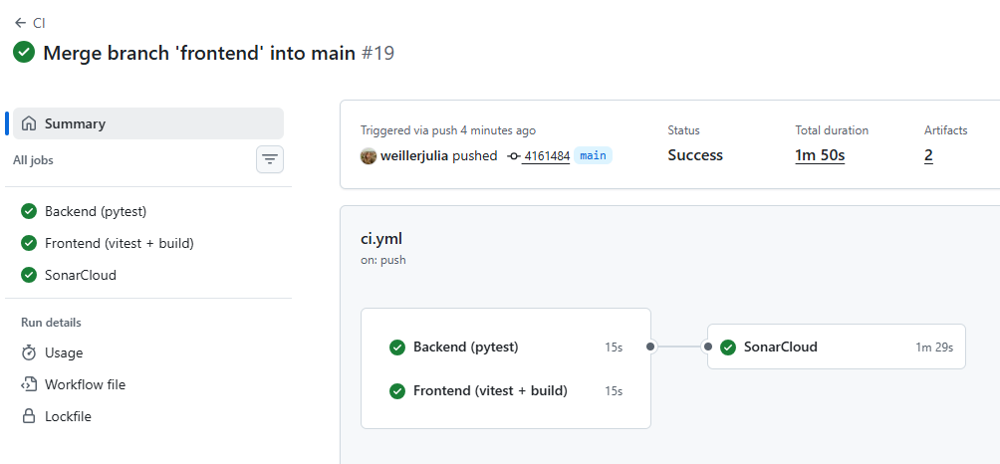
</p>

### Qualidade do código

Análise contínua no [SonarQube Cloud](https://sonarcloud.io/project/overview?id=weillerjulia_StockWise):
bugs, vulnerabilidades, code smells, duplicação e cobertura.

<p align="center">
  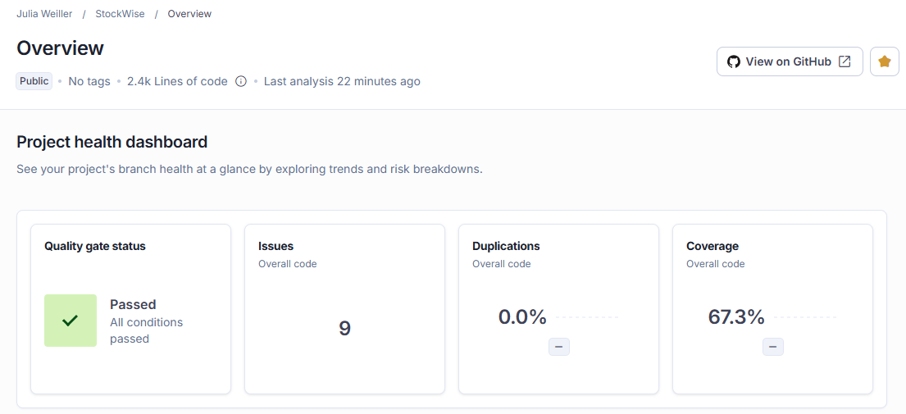
</p>

| Critério | Nota | Questões em aberto |
|---|:---:|---|
| Segurança | B | 3, de severidade alta |
| Confiabilidade | A | 0 |
| Manutenibilidade | A | 0 |
| Revisão de security hotspots | A | 0 |

Análise do código completo (*Overall code*) em 07/11/2026.

### Privacidade e LGPD

- O sistema processa **dados de produtos e estoque**, não dados pessoais: não há
  nome, CPF, e-mail ou outro identificador de pessoa física.
- Não há login nem cadastro de usuários, então nenhum dado pessoal é coletado
  pela interface.
- A chave do banco fica só no `.env` do backend, que não é versionado
  (`.gitignore`). O navegador nunca recebe essa chave.

---

## 14. Resultados e validação

### Validação com a empresa

Os cálculos foram alinhados e validados com o gestor de uma empresa de
autopeças, que também forneceu o CSV exportado do ERP de estoque. Esse arquivo
foi a base usada no desenvolvimento e nos testes do sistema, complementada com
alguns produtos criados pela autora para cobrir situações que não apareciam nos
dados originais.

A margem mínima de 10% usada no desconto máximo foi definida em conjunto com
o gestor e, por isso, está fixa no sistema atualmente.

### Conferência dos valores calculados

Os valores exibidos no sistema foram conferidos um a um contra uma planilha que
recalcula cada fórmula de forma independente, usando a base de 56 produtos
descrita acima: o CSV do gestor complementado com os produtos de teste
([validacao-valores-stockwise.xlsx](docs/validacao-valores-stockwise.xlsx)).

| Verificação | Comparações | Divergências |
|---|---|---|
| Dados do CSV × dados gravados | 840 | 0 |
| Custo gerencial (dias, armazenagem, oportunidade, composto) | 224 | 0 |
| Giro (30, 90 e 180 dias) | 168 | 0 |
| Desconto máximo (R$ e %) | 112 | 0 |
| Classificação (score e faixa) | 112 | 0 |
| Valores exibidos na tela Produtos | 336 | 0 |
| Indicadores, gráficos e listas do Dashboard (por unidade e em estoque) | 86 | 0 |
| **Total** | **1.878** | **0** |

A aba do Dashboard foi refeita em 08/11/2026 para a Visão geral redesenhada.
Ela confere os cartões por unidade e em estoque, o giro típico (mediana), a
frase de resumo, a distribuição por prioridade, os Top 5, os totais das
categorias e a divisão de cada barra por prioridade. Os valores da tela vêm
da página real renderizada em ambiente de teste com os dados gravados no banco.

### Validação da classificação com K-Means

O notebook [clustering_kmeans.ipynb](backend/analysis/clustering_kmeans.ipynb)
agrupa os produtos com K-Means, usando as mesmas três dimensões da regra, e
compara produto a produto:

| Versão da regra | Distribuição (Alta / Média / Baixa) | Concordância com o K-Means |
|---|---|---|
| Pesos iguais (1/3 cada) | 48 de 56 em Média | 46% |
| Pesos 40% / 40% / 20% | 13 / 28 / 15 | cerca de 82% |

---

## 15. Aderência à linha Web

| Requisito da linha | Como o StockWise atende | Onde ver |
|---|---|---|
| Sistema acessível | Execução local, conforme acordado com a orientação. | [Como rodar](#17-como-rodar-o-projeto) |
| Funcionalidades completas e reais, conforme a RFC | Importação, cálculos, Dashboard, tabela, exportação e Ajuda. | [Funcionalidades](#3-funcionalidades-e-diferencial), [RFC](docs/RFC.md) |
| Interface funcional, navegável e com usabilidade básica | 4 telas com menu fixo, tooltips em cada métrica e página de Ajuda. | [Navegação](#8-estrutura-de-navegação) |
| Arquitetura definida conforme a RFC | Camadas cliente-servidor: React → FastAPI → PostgreSQL. | [Arquitetura](#9-arquitetura) |
| Organização modular do código | Rotas, serviços puros e repositório no backend; páginas, componentes e hooks no frontend. | [Organização modular](#organização-modular-do-código) |
| Código-fonte com histórico de commits | Repositório no GitHub, com o histórico completo. | [Commits](https://github.com/weillerjulia/StockWise/commits) |
| Requisitos funcionais | RF01 a RF12, ligados aos casos de uso. | [Requisitos](#5-requisitos) |
| Casos de uso | Diagrama UML e UC01 a UC07 detalhados. | [Casos de uso](#6-casos-de-uso) |
| Diagrama de arquitetura (C4) | Contexto, Contêineres e Componentes. | [Arquitetura](#9-arquitetura) |
| Instruções de deploy | Execução local do banco, da API e do frontend. | [Como rodar](#17-como-rodar-o-projeto) |
| Pelo menos três fluxos de negócio completos | Importar o estoque, analisar na Visão geral e planejar a promoção. | [Fluxos de negócio](#7-fluxos-de-negócio) |
| Cobertura de testes: 75% backend e 25% frontend | 90% no backend e 83,05% no frontend, verificados no CI. | [Testes](#13-qualidade-testes-e-privacidade) |

---

## 16. Trabalhos futuros

- Integração direta com o ERP.
- Histórico e comparação entre importações.
- Informar a data de extração do CSV no upload, para que os dias em estoque não
  dependam do dia da importação.
- Gravação atômica da importação.
- Hospedagem pública.

---

## 17. Como rodar o projeto

### Pré-requisitos

| Ferramenta | Versão |
|---|---|
| Python | 3.14 |
| Node.js | 24 |
| Git | qualquer versão recente |
| Conta no Supabase | plano gratuito |

### 1. Clonar o repositório

```bash
git clone https://github.com/weillerjulia/StockWise.git
cd StockWise
```

### 2. Criar o banco no Supabase

1. Crie um projeto no [Supabase](https://supabase.com/).
2. No **SQL Editor**, rode o script [backend/db/schema.sql](backend/db/schema.sql).
   Ele cria as tabelas `produtos`, `importacoes`, `estoque_snapshots` e
   `resultados_analise`.
3. Em **Project Settings → API**, copie a **Project URL** e a **service_role key**.

### 3. Backend (FastAPI)

```bash
cd backend
python -m venv .venv
.venv\Scripts\activate          # Windows
# source .venv/bin/activate     # Linux ou macOS
pip install -r requirements.txt
cp .env.example .env
```

Preencha o `backend/.env`:

| Variável | Descrição | Exemplo |
|---|---|---|
| `SUPABASE_URL` | Project URL do Supabase | `https://xxxxxxxx.supabase.co` |
| `SUPABASE_KEY` | service_role key do Supabase | — |
| `ENVIRONMENT` | Ambiente de execução | `development` |
| `FRONTEND_ORIGIN` | Endereço do frontend, liberado no CORS | `http://localhost:5173` |

Suba a API:

```bash
uvicorn app.main:app --reload
```

A API fica em <http://localhost:8000>. Confira em <http://localhost:8000/health>.

### 4. Frontend (React + Vite)

Em outro terminal:

```bash
cd frontend
npm install
cp .env.example .env
npm run dev
```

O `frontend/.env` tem só a variável `VITE_API_BASE_URL`
(padrão `http://localhost:8000`).

Acesse <http://localhost:5173> e importe um CSV na tela **Upload**.

### 5. Análise exploratória (opcional)

```bash
cd backend
pip install -r analysis/requirements.txt
jupyter notebook analysis/clustering_kmeans.ipynb
```

O notebook lê as credenciais do mesmo `backend/.env` e analisa, por padrão, a
importação mais recente.

### Problemas comuns

| Sintoma | Causa provável |
|---|---|
| `Failed to fetch` ao importar | API fora do ar ou `FRONTEND_ORIGIN` diferente do endereço do frontend. |
| Erro 500 ao importar | Supabase pausado por inatividade: reative o projeto no painel. |
| Acentos incorretos nos nomes | CSV em uma codificação diferente de UTF-8, CP1252 ou Mac Roman. |

---

## 18. Referências

**Documentação do projeto**

- [RFC: arquitetura e decisões técnicas](docs/RFC.md)
- [Casos de uso](docs/casos-de-uso.md)
- [Documentação técnica](docs/DOCUMENTACAO-TECNICA.md)

**Tecnologias**

- [FastAPI](https://fastapi.tiangolo.com/)
- [React](https://react.dev/)
- [Vite](https://vitejs.dev/)
- [Supabase](https://supabase.com/docs)
- [scikit-learn: K-Means](https://scikit-learn.org/stable/modules/clustering.html#k-means)
- [Modelo C4](https://c4model.com/)
- [Mermaid](https://mermaid.js.org/)
- [PlantUML](https://plantuml.com/)

---

## 19. Autora

**Julia Weiller**<br/>
Universidade Católica de Santa Catarina, Jaraguá do Sul, SC<br/>
[julia.weiller@catolicasc.edu.br](mailto:julia.weiller@catolicasc.edu.br)

*Trabalho de Conclusão de Curso · Linha de Projeto Web Apps · PAC 7/8 · 2026*
