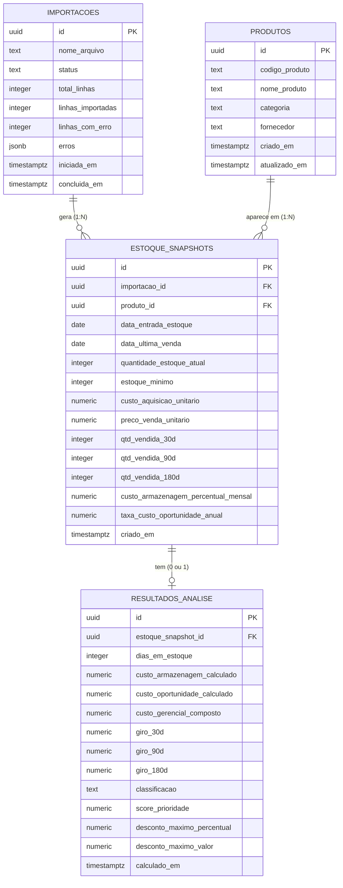

# Documentação Técnica — StockWise

> Documento de estudo para quem vai ler, manter ou evoluir o código do
> StockWise pela primeira vez. Cobre visão geral, estrutura de pastas, banco
> de dados, backend, frontend, os fluxos principais do sistema e os
> resultados de testes e qualidade, com exemplos reais extraídos do
> repositório.
>
> Complementa (não substitui) [`README.md`](../README.md),
> [`docs/RFC.md`](RFC.md) e [`docs/casos-de-uso.md`](casos-de-uso.md).

---

## 1. Visão Geral

### 1.1 Objetivo do sistema e problema que resolve

O **StockWise** é um sistema de apoio à decisão para empresas do setor de
autopeças. Ele não substitui o ERP da empresa — funciona como uma **camada
analítica complementar**: recebe um snapshot do estoque (hoje, via upload
manual de um arquivo CSV exportado do ERP) e calcula indicadores gerenciais
que o ERP tradicional não fornece.

ERPs de estoque respondem "quanto tenho, quanto entrou, quanto saiu". Eles
não respondem:

- *Qual é o custo real de manter este produto parado há 8 meses?*
- *Qual o desconto máximo que posso aplicar numa promoção sem ter prejuízo?*
- *Quais produtos devo priorizar numa campanha promocional?*

O StockWise responde a essas três perguntas calculando, para cada produto:

1. **Custo gerencial composto** — custo de aquisição + custo de armazenagem
   acumulado + custo de oportunidade do capital imobilizado, proporcionais
   ao tempo em estoque.
2. **Giro de estoque** em três janelas temporais (30, 90, 180 dias),
   anualizado para permitir comparação entre elas.
3. **Classificação de prioridade** (Alta/Média/Baixa), um ranking relativo
   que combina custo (40%), giro (40%) e nível de estoque (20%).
4. **Desconto máximo sugerido**, o maior desconto que pode ser aplicado ao
   preço de venda sem violar uma margem mínima de segurança.

### 1.2 Stack tecnológica

**Backend**
- Python 3.14 (versão usada no CI), [FastAPI](https://fastapi.tiangolo.com/), Uvicorn (servidor ASGI)
- `pydantic-settings` — configuração via `.env`
- `python-multipart` — necessário para receber upload de arquivo (`UploadFile`)
- Parsing de CSV com o módulo padrão `csv` (não usa pandas na API)
- `supabase` (cliente Python) — acesso ao Postgres via API REST do Supabase
- `pytest` + `httpx` (`TestClient`) — testes automatizados
- `pytest-cov` — cobertura de testes

**Frontend**
- Node.js 24 (versão usada no CI)
- React 19 + TypeScript, [Vite](https://vitejs.dev/) (dev server/build)
- `react-router-dom` v7 — roteamento entre telas
- Tailwind CSS v4 — estilização utilitária
- `lucide-react` — ícones
- `recharts` — gráficos do dashboard
- `vitest` + `@testing-library/react` — testes de componentes
- `@vitest/coverage-v8` — cobertura de testes

**Qualidade e CI**
- GitHub Actions — testes, cobertura e build a cada push ou pull request
- SonarQube Cloud — análise estática e cobertura

**Análise exploratória** (isolada, fora do fluxo web)
- Jupyter Notebook, `pandas`, `scikit-learn` (K-Means,
  silhouette score), `matplotlib`, `python-dotenv`

**Banco de dados**
- PostgreSQL gerenciado pelo Supabase

### 1.3 Arquitetura geral

O sistema é organizado em **três camadas**, com uma regra rígida: o
frontend nunca acessa o banco diretamente, apenas a API.

```
CSV (upload manual do usuário)
        │
        ▼
Backend FastAPI  ──────────────►  Supabase (PostgreSQL)
        ▲                          (única credencial de banco fica no backend)
        │  API REST (JSON)
        │
Frontend React (SPA)
```

- **Camada de dados**: o CSV exportado do ERP (entrada manual).
- **Camada de processamento**: o backend FastAPI, que decodifica/valida o
  CSV, executa os módulos de cálculo (custo gerencial, giro, classificação,
  desconto máximo) e persiste no Supabase.
- **Camada de apresentação**: o frontend React, que consome a API REST via
  `fetch` e renderiza dashboards e tabelas.

Não é um MVC clássico. É mais próximo de uma arquitetura em camadas com
**API REST stateless** no backend: cada rota FastAPI delega para funções de
serviço (regras de negócio puras, sem I/O) e para um módulo de repositório
(único ponto que fala com o Supabase). Não há autenticação/autorização
nesta fase — é um PoC de usuário único, sem multi-tenant.

> A análise exploratória com K-Means (`backend/analysis/`) roda à parte, em
> um notebook Jupyter que lê diretamente do Supabase. Não faz parte do
> fluxo da aplicação web — serve só para validar a classificação por
> regras do módulo 4 com um método não supervisionado.

---

## 2. Estrutura de Pastas

```
StockWise/
├── .github/workflows/ci.yml     # CI: testes, cobertura, build e SonarCloud
├── sonar-project.properties     # configuração da análise do SonarCloud
├── backend/
│   ├── app/
│   │   ├── main.py              # cria o FastAPI app, registra CORS e routers
│   │   ├── api/                 # rotas HTTP (camada de apresentação da API)
│   │   │   ├── health.py        # GET /health
│   │   │   └── importacoes.py   # POST /importacoes, GET /importacoes/{id}...
│   │   ├── core/
│   │   │   └── config.py        # Settings (lê .env) via pydantic-settings
│   │   ├── db/
│   │   │   └── supabase_client.py  # cliente Supabase (singleton via lru_cache)
│   │   └── services/            # regras de negócio, puras (sem I/O de rede)
│   │       ├── csv_import.py            # módulo 1: parsing/validação do CSV
│   │       ├── custo_gerencial.py       # módulo 2: custo gerencial composto
│   │       ├── giro_estoque.py          # módulo 3: giro de estoque
│   │       ├── classificacao_estoque.py # módulo 4: classificação de prioridade
│   │       ├── desconto_maximo.py       # módulo 5: desconto máximo sugerido
│   │       └── importacoes_repository.py # módulo 6: acesso ao Supabase (I/O)
│   ├── db/
│   │   └── schema.sql            # script de criação das tabelas no Supabase
│   ├── analysis/
│   │   ├── clustering_kmeans.ipynb  # notebook standalone de K-Means
│   │   └── requirements.txt
│   ├── tests/                    # testes pytest dos cálculos, do CSV e das rotas (repositório via mocks)
│   ├── .env.example              # modelo das variáveis de ambiente
│   ├── .coveragerc               # configuração da cobertura
│   ├── requirements.txt
│   └── pytest.ini
│
├── frontend/
│   ├── .env.example               # modelo das variáveis de ambiente
│   └── src/
│       ├── main.tsx               # ponto de entrada (ReactDOM.createRoot)
│       ├── App.tsx                # define as rotas (react-router-dom)
│       ├── App.test.tsx           # teste do layout
│       ├── index.css              # estilos globais
│       ├── setupTests.ts          # configuração dos testes
│       ├── api/
│       │   ├── client.ts          # funções fetch para a API (uploadCsv, etc.)
│       │   ├── types.ts           # tipos TypeScript espelhando o payload da API
│       │   └── storage.ts         # leitura/escrita do id da última importação no localStorage
│       ├── hooks/
│       │   └── useResultadosUltimaImportacao.ts  # hook que busca os resultados da última importação
│       ├── pages/                 # uma tela por rota (e os testes *.test.tsx de Upload e Produtos)
│       │   ├── UploadPage.tsx     # rota "/" — upload do CSV
│       │   ├── DashboardPage.tsx  # rota "/dashboard" — indicadores agregados
│       │   ├── ProdutosPage.tsx   # rota "/produtos" — tabela de produtos
│       │   └── AjudaPage.tsx      # rota "/ajuda" — explicação das fórmulas
│       ├── components/
│       │   ├── layout/            # AppLayout, Sidebar, Topbar (casca da aplicação)
│       │   ├── KpiCard.tsx        # card de indicador numérico
│       │   ├── ClassificacaoBadge.tsx  # pílula colorida por classificação
│       │   ├── MapaPrioridadeChart.tsx # dispersão giro × custo gerencial do Dashboard
│       │   ├── HelpTooltip.tsx    # tooltip de ajuda inline (colunas da tabela e cards do Dashboard)
│       │   └── Pagination.tsx     # paginação client-side da tabela de produtos
│       └── utils/
│           ├── format.ts          # formatação de moeda/número/data em pt-BR
│           └── exportCsv.ts       # exportação da tabela de produtos para CSV
│
└── docs/
    ├── RFC.md              # decisões técnicas e trade-offs
    ├── casos-de-uso.md     # casos de uso (UC01–UC07)
    └── DOCUMENTACAO-TECNICA.md  # este documento
```

---

## 3. Banco de Dados

O schema completo está em [`backend/db/schema.sql`](../backend/db/schema.sql)
e é aplicado manualmente no SQL Editor do Supabase. São **4 tabelas**,
deliberadamente separadas em dado descritivo, dado bruto importado e dado
calculado (ver RFC seção 5.2) — isso permite manter histórico entre
importações e deixa o modelo pronto para um futuro reprocessamento sem
reimportar o CSV. Esse reprocessamento ainda não existe no código.

### 3.1 Tabela `produtos`

Dimensão descritiva do produto. Um registro por `codigo_produto` — é feito
**upsert** nela a cada importação (se o código já existe, atualiza nome,
categoria, fornecedor e `atualizado_em`; se não existe, cria).

| Coluna | Tipo | Nulo? | Chave / Constraint | Default |
|---|---|---|---|---|
| `id` | `uuid` | não | **PK** | `gen_random_uuid()` |
| `codigo_produto` | `text` | não | **unique** | — |
| `nome_produto` | `text` | não | — | — |
| `categoria` | `text` | sim | — | — |
| `fornecedor` | `text` | sim | — | — |
| `criado_em` | `timestamptz` | não | — | `now()` |
| `atualizado_em` | `timestamptz` | não | — | `now()` |

### 3.2 Tabela `importacoes`

Um registro por upload de CSV — dá rastreabilidade/auditoria de cada
importação (quando rodou, quantas linhas, quais erros).

| Coluna | Tipo | Nulo? | Chave / Constraint | Default |
|---|---|---|---|---|
| `id` | `uuid` | não | **PK** | `gen_random_uuid()` |
| `nome_arquivo` | `text` | não | — | — |
| `status` | `text` | não | `check (status in ('processando','concluida','concluida_com_erros','falhou'))` | `'processando'` |
| `total_linhas` | `integer` | não | — | `0` |
| `linhas_importadas` | `integer` | não | — | `0` |
| `linhas_com_erro` | `integer` | não | — | `0` |
| `erros` | `jsonb` | não | array de `{linha, mensagem}` | `'[]'::jsonb` |
| `iniciada_em` | `timestamptz` | não | — | `now()` |
| `concluida_em` | `timestamptz` | sim | — | — |

### 3.3 Tabela `estoque_snapshots`

Tabela fato: uma linha por produto **em cada importação** — é o que veio
literalmente do CSV (dado bruto), sem cálculo. Permite comparar o mesmo
produto ao longo de importações diferentes.

| Coluna | Tipo | Nulo? | Chave / Constraint | Default |
|---|---|---|---|---|
| `id` | `uuid` | não | **PK** | `gen_random_uuid()` |
| `importacao_id` | `uuid` | não | **FK** → `importacoes(id)` `on delete cascade` | — |
| `produto_id` | `uuid` | não | **FK** → `produtos(id)` `on delete cascade` | — |
| `data_entrada_estoque` | `date` | sim | — | — |
| `data_ultima_venda` | `date` | sim | — | — |
| `quantidade_estoque_atual` | `integer` | não | — | `0` |
| `estoque_minimo` | `integer` | não | — | `0` |
| `custo_aquisicao_unitario` | `numeric(12,2)` | não | — | — |
| `preco_venda_unitario` | `numeric(12,2)` | sim | — | — |
| `qtd_vendida_30d` | `integer` | não | — | `0` |
| `qtd_vendida_90d` | `integer` | não | — | `0` |
| `qtd_vendida_180d` | `integer` | não | — | `0` |
| `custo_armazenagem_percentual_mensal` | `numeric(6,3)` | não | — | `0` |
| `taxa_custo_oportunidade_anual` | `numeric(6,3)` | não | — | `0` |
| `criado_em` | `timestamptz` | não | — | `now()` |
| — | — | — | **unique** `(importacao_id, produto_id)` — um mesmo produto não pode aparecer 2x na mesma importação | — |

Índices: `idx_estoque_snapshots_produto` em `produto_id`,
`idx_estoque_snapshots_importacao` em `importacao_id`.

### 3.4 Tabela `resultados_analise`

Dado **calculado** pelos módulos 2–5 do backend. Relação **1:1** com
`estoque_snapshots` (cada snapshot tem no máximo um resultado, garantido
pelo `unique` na FK).

| Coluna | Tipo | Nulo? | Chave / Constraint | Default |
|---|---|---|---|---|
| `id` | `uuid` | não | **PK** | `gen_random_uuid()` |
| `estoque_snapshot_id` | `uuid` | não | **FK unique** → `estoque_snapshots(id)` `on delete cascade` | — |
| `dias_em_estoque` | `integer` | sim | — | — |
| `custo_armazenagem_calculado` | `numeric(12,2)` | sim | — | — |
| `custo_oportunidade_calculado` | `numeric(12,2)` | sim | — | — |
| `custo_gerencial_composto` | `numeric(12,2)` | sim | — | — |
| `giro_30d` | `numeric(8,4)` | sim | — | — |
| `giro_90d` | `numeric(8,4)` | sim | — | — |
| `giro_180d` | `numeric(8,4)` | sim | — | — |
| `classificacao` | `text` | sim | — | — |
| `score_prioridade` | `numeric(8,4)` | sim | — | — |
| `desconto_maximo_percentual` | `numeric(5,2)` | sim | — | — |
| `desconto_maximo_valor` | `numeric(12,2)` | sim | — | — |
| `calculado_em` | `timestamptz` | não | — | `now()` |

Índice: `idx_resultados_snapshot` em `estoque_snapshot_id`.

### 3.5 Relacionamentos entre tabelas

- `importacoes` **1 : N** `estoque_snapshots` — uma importação gera vários
  snapshots (um por linha válida do CSV). FK: `estoque_snapshots.importacao_id → importacoes.id`.
- `produtos` **1 : N** `estoque_snapshots` — um produto pode aparecer em
  vários snapshots ao longo de importações diferentes (histórico). FK:
  `estoque_snapshots.produto_id → produtos.id`.
- `estoque_snapshots` **1 : 0..1** `resultados_analise` — o fluxo de
  importação grava um resultado por snapshot, mas o schema permite snapshot
  sem resultado (ex.: falha no meio da gravação). FK: `resultados_analise.estoque_snapshot_id → estoque_snapshots.id`
  (marcada `unique`, o que limita a relação a no máximo um resultado).
- Não há relação N:N no schema.

Todas as FKs têm `on delete cascade`: apagar uma importação apaga seus
snapshots, que por sua vez apagam seus resultados de análise.

### 3.6 Diagrama ER



---

## 4. Backend

### 4.1 Endpoints da API

Todos os endpoints estão registrados em [`backend/app/main.py`](../backend/app/main.py)
via `app.include_router(...)`.

#### `GET /health`
Healthcheck simples, sem dependências externas.
- **Resposta 200**: `{"status": "ok"}`

#### `POST /importacoes`
Recebe o upload do CSV e dispara todo o pipeline de cálculo (ver seção 6.1).
- **Parâmetros**: `multipart/form-data` com campo `arquivo` (arquivo CSV)
- **Resposta 200** (sucesso, com ou sem erros de linha):
  ```json
  {
    "id": "uuid-da-importacao",
    "nome_arquivo": "estoque.csv",
    "status": "concluida" | "concluida_com_erros",
    "total_linhas": 120,
    "linhas_importadas": 118,
    "linhas_com_erro": 2,
    "erros": [{"linha": 15, "mensagem": "campo obrigatório 'nome_produto' vazio"}]
  }
  ```
- **Resposta 400**: a rota trata a falha de decodificação, mas ela não
  ocorre com a cadeia atual, porque `mac_roman` aceita qualquer byte.
- **Resposta 500**: falha ao gravar no Supabase. O corpo da resposta e o
  status da importação dependem de onde a falha ocorre (ver seção 6.1).

#### `GET /importacoes/{importacao_id}/resultados`
Retorna todos os resultados calculados de uma importação, com os dados do
produto e da análise já "embutidos" (join feito pelo PostgREST do Supabase).
- **Parâmetros de rota**: `importacao_id` (uuid)
- **Resposta 200**: lista de objetos, um por snapshot:
  ```json
  [
    {
      "id": "uuid-do-snapshot",
      "preco_venda_unitario": 34.90,
      "quantidade_estoque_atual": 12,
      "estoque_minimo": 5,
      "produtos": { "codigo_produto": "...", "nome_produto": "...", "categoria": "...", "fornecedor": "..." },
      "resultados_analise": {
        "custo_gerencial_composto": 22.69,
        "giro_30d": 3.1, "giro_90d": 5.89, "giro_180d": 4.2,
        "classificacao": "Prioridade Alta",
        "score_prioridade": 0.81,
        "desconto_maximo_percentual": 28.48,
        "desconto_maximo_valor": 9.94,
        "dias_em_estoque": 45
      }
    }
  ]
  ```

#### `GET /importacoes/{importacao_id}`
Retorna os metadados de uma importação (status, contagens, timestamps) —
usado pela tela de Upload para mostrar o resumo da "última importação".
- **Resposta 200**: objeto `importacoes` (ver seção 3.2)
- **Resposta 404**: `{"detail": "importação não encontrada"}`

### 4.2 Serviços e regras de negócio

Cada módulo de serviço em `backend/app/services/` é **puro** (recebe
dados, devolve dados, sem falar com o banco) — exceto
`importacoes_repository.py`, que é o único ponto de I/O com o Supabase.
Essa separação existe para que os cálculos sejam testáveis isoladamente
(ver `backend/tests/`).

| Módulo | Arquivo | Responsabilidade |
|---|---|---|
| 1 — Importação | [`csv_import.py`](../backend/app/services/csv_import.py) | Decodifica o arquivo (fallback UTF-8 → CP1252 → Mac Roman), detecta delimitador (`csv.Sniffer`), faz parsing de datas/moeda/percentual/inteiro e valida linha a linha |
| 2 — Custo gerencial | [`custo_gerencial.py`](../backend/app/services/custo_gerencial.py) | Calcula custo de armazenagem + custo de oportunidade + custo de aquisição, proporcionais aos dias em estoque |
| 3 — Giro de estoque | [`giro_estoque.py`](../backend/app/services/giro_estoque.py) | Calcula o giro anualizado nas janelas de 30/90/180 dias |
| 4 — Classificação | [`classificacao_estoque.py`](../backend/app/services/classificacao_estoque.py) | Rankeia cada produto (custo, giro, nível de estoque) **relativo ao lote da importação**, combina os ranks com pesos 40/40/20 e converte em Prioridade Alta/Média/Baixa |
| 5 — Desconto máximo | [`desconto_maximo.py`](../backend/app/services/desconto_maximo.py) | Calcula o maior desconto aplicável sem violar a margem mínima (10% por padrão) |
| 6 — Repositório | [`importacoes_repository.py`](../backend/app/services/importacoes_repository.py) | Único módulo que chama `get_supabase_client()` — cria/atualiza importações, faz upsert de produtos, insere snapshots e resultados |

A orquestração desses módulos acontece na rota `POST /importacoes`
([`importacoes.py`](../backend/app/api/importacoes.py)), em 3 etapas
sequenciais explícitas:

1. Cálculo puro (custo gerencial + giro) para cada linha válida, sem tocar
   no banco.
2. Classificação em lote — precisa de **todas** as linhas calculadas de
   uma vez, porque o rank é relativo ao lote.
3. Persistência: para cada linha, calcula o desconto máximo (depende do
   custo já calculado) e grava produto → snapshot → resultado no Supabase.

Um exemplo de regra de negócio real, o cálculo do custo gerencial
composto:

```python
# backend/app/services/custo_gerencial.py
def calcular_custo_gerencial(
    *, custo_aquisicao_unitario, custo_armazenagem_percentual_mensal,
    taxa_custo_oportunidade_anual, data_entrada_estoque, data_referencia,
) -> ResultadoCustoGerencial:
    dias_em_estoque = max((data_referencia - data_entrada_estoque).days, 0)
    dias = Decimal(dias_em_estoque)

    custo_armazenagem_calculado = _arredondar(
        custo_aquisicao_unitario * (custo_armazenagem_percentual_mensal / CEM) * (dias / DIAS_POR_MES)
    )
    custo_oportunidade_calculado = _arredondar(
        custo_aquisicao_unitario * (taxa_custo_oportunidade_anual / CEM) * (dias / DIAS_POR_ANO)
    )
    custo_gerencial_composto = _arredondar(
        custo_aquisicao_unitario + custo_armazenagem_calculado + custo_oportunidade_calculado
    )
    ...
```

Note o uso de `Decimal` (não `float`) em todos os cálculos monetários —
evita erros de arredondamento binário em valores financeiros.

### 4.3 Configuração e CORS

[`app/core/config.py`](../backend/app/core/config.py) define `Settings`
(pydantic-settings), lida do arquivo `.env`: `supabase_url`,
`supabase_key`, `environment`, `frontend_origin`. O cliente Supabase
([`app/db/supabase_client.py`](../backend/app/db/supabase_client.py)) é um
singleton (`@lru_cache`) criado a partir dessas settings.

`frontend_origin` alimenta o `CORSMiddleware` em `main.py` — necessário
porque frontend (porta 5173) e backend (porta 8000) rodam em origens
diferentes; sem isso o navegador bloqueia as respostas da API.

### 4.4 Autenticação/autorização

**Não existe.** É uma decisão de escopo explícita do PoC (ver RFC seções
5.11 e 6): o sistema é aberto, sem login, e qualquer pessoa com acesso à URL do frontend pode importar dados e ver
os resultados. Não há diferenciação de usuários/perfis — o único "estado
de sessão" é o `id` da última importação, guardado no `localStorage` do
navegador (ver seção 5.2).

---

## 5. Frontend

### 5.1 Telas e componentes

O roteamento é definido em [`App.tsx`](../frontend/src/App.tsx) com 4 rotas,
todas envolvidas pelo `AppLayout` (sidebar fixa + topbar + área de
conteúdo):

| Rota | Página | O que faz |
|---|---|---|
| `/` | [`UploadPage.tsx`](../frontend/src/pages/UploadPage.tsx) | Formulário de upload do CSV (drag-and-drop ou clique), mostra o formato esperado, o resumo pós-upload (linhas totais/importadas/com erro + tabela de erros por linha) e um resumo da última importação salva |
| `/dashboard` | [`DashboardPage.tsx`](../frontend/src/pages/DashboardPage.tsx) | KPIs agregados (valor imobilizado total/crítico, potencial de recuperação, risco de ruptura, giro médio), gráfico de barras por classificação, mapa de prioridade (dispersão giro × custo), gráfico de valor imobilizado por categoria, top 5 por custo e top 5 parados há mais tempo. Os indicadores em R$ somam valores por unidade, sem multiplicar pela quantidade em estoque (RFC seção 6) |
| `/produtos` | [`ProdutosPage.tsx`](../frontend/src/pages/ProdutosPage.tsx) | Tabela paginada de produtos com busca por nome/código, filtro por classificação, ordenação por coluna (custo, giro, desconto) e exportação para CSV |
| `/ajuda` | [`AjudaPage.tsx`](../frontend/src/pages/AjudaPage.tsx) | Explicação didática (com fórmulas e exemplos numéricos) de cada indicador calculado pelo backend e resumo da validação da classificação com K-Means |

Componentes reutilizáveis (`frontend/src/components/`):
- **`AppLayout` / `Sidebar` / `Topbar`** — casca visual comum a todas as
  telas (navegação, título da página).
- **`KpiCard`** — card genérico de indicador numérico (label + valor +
  cor/alerta opcional + ícone de ajuda opcional via prop `ajuda`), usado no
  Dashboard e na Upload.
- **`ClassificacaoBadge`** — pílula colorida (vermelho/laranja/verde) para
  a classificação de prioridade.
- **`HelpTooltip`** — ícone de ajuda com texto explicativo, usado nos
  cabeçalhos de coluna da tabela de Produtos e nos cards de indicadores do
  Dashboard.
- **`Pagination`** — controle de paginação client-side, com seletor de
  itens por página (10, 25, 50 ou 100).
- **`MapaPrioridadeChart`** — gráfico de dispersão (giro 90d × custo
  gerencial) do Dashboard, um ponto por produto. A classificação é
  codificada por cor **e** formato do marcador (triângulo/losango/círculo),
  para não depender só de vermelho × verde; linhas de mediana do lote e o
  quadrante "Parado e caro" destacado. Produtos com giro nulo ficam de fora.

### 5.2 Como o frontend se comunica com o backend

Toda comunicação passa por [`api/client.ts`](../frontend/src/api/client.ts),
que usa `fetch` puro (sem biblioteca HTTP) contra
`VITE_API_BASE_URL` (padrão `http://localhost:8000`):

```typescript
// frontend/src/api/client.ts
export async function uploadCsv(arquivo: File): Promise<RespostaUpload> {
  const formData = new FormData();
  formData.append("arquivo", arquivo);

  const resposta = await fetch(`${API_BASE_URL}/importacoes`, {
    method: "POST",
    body: formData,
  });

  if (!resposta.ok) {
    throw new Error(await extrairMensagemErro(resposta, "Falha ao importar o arquivo."));
  }
  return resposta.json();
}
```

Os tipos TypeScript em [`api/types.ts`](../frontend/src/api/types.ts)
espelham manualmente o formato JSON devolvido pela API (não há geração
automática de tipos a partir do backend).

Como a API não tem endpoint para "listar importações" ou "obter a mais
recente" (decisão de escopo do PoC, RFC 5.7), o frontend guarda o `id` da
última importação no `localStorage` sob a chave
`stockwise:ultimaImportacaoId` ([`api/storage.ts`](../frontend/src/api/storage.ts)).
O hook [`useResultadosUltimaImportacao.ts`](../frontend/src/hooks/useResultadosUltimaImportacao.ts)
lê esse `id` e busca `GET /importacoes/{id}/resultados`, expondo um estado
`"carregando" | "vazio" | "erro" | "sucesso"` consumido pelas telas de
Dashboard e Produtos.

Filtro, ordenação e paginação da tabela de Produtos são feitos inteiramente
**no navegador** — a API sempre devolve o lote completo da importação (RFC
5.8), aceitável para o volume de dados de um PoC.

---

## 6. Fluxos Principais

### 6.1 Fluxo 1 — Importação de CSV (do frontend ao banco)

Este é o fluxo central do sistema (UC01 em [`casos-de-uso.md`](casos-de-uso.md)).

1. **Frontend** — o usuário arrasta ou seleciona um `.csv` em `UploadPage`
   e clica em "Importar". `handleSubmit` chama `uploadCsv(arquivo)`, que
   envia um `POST /importacoes` com `multipart/form-data`.
2. **Backend — decodificação** (`csv_import._decodificar`) — tenta `utf-8-sig`,
   depois `cp1252`, depois `mac_roman`, nessa ordem (o último nunca falha,
   por isso vem por último). Na prática, não há erro de decodificação: um
   arquivo em outra codificação pode ser importado com acentos incorretos.
3. **Backend — detecção de formato** (`csv_import._detectar_delimitador`,
   `_parse_moeda`) — usa `csv.Sniffer` para achar o delimitador (`;`, `,`
   ou tab) e decide se o valor monetário está em formato BR (`R$ 1.234,56`)
   ou decimal com ponto (`18.5`) olhando se há vírgula no valor. Valores
   ambíguos ou malformados (`1.234`, `1,234`, `1,234.50`) são recusados e
   entram como erro da linha.
4. **Backend — validação linha a linha** (`csv_import._validar_linha`) —
   confere os 5 campos obrigatórios (`codigo_produto`, `nome_produto`,
   `data_entrada_estoque`, `quantidade_estoque_atual`,
   `custo_aquisicao_unitario`), faz parsing de data/moeda/percentual/inteiro
   e detecta códigos de produto duplicados dentro do mesmo arquivo. Linhas
   inválidas geram um `ErroLinha` e **não interrompem** o processamento das
   demais.
5. **Backend — cálculo em 3 etapas** (rota `POST /importacoes` em
   `importacoes.py`):
   - Para cada linha válida: `calcular_custo_gerencial(...)` e
     `calcular_giro(...)` (independentes entre linhas).
   - Com o lote completo calculado: `classificar_lote(...)` rankeia as
     linhas entre si (custo, giro 90d, razão de estoque) e atribui
     Prioridade Alta/Média/Baixa.
   - Para cada linha, agora com a classificação em mãos:
     `calcular_desconto_maximo(...)` usa o custo gerencial já calculado.
6. **Backend — persistência** (`importacoes_repository.py`) — cria o
   registro em `importacoes` (status `processando`), depois para cada
   linha: `upsert_produto` (por `codigo_produto`) → `inserir_snapshot`
   (dado bruto do CSV) → `inserir_resultado_analise` (dado calculado). Ao
   final, `finalizar_importacao` grava o resumo (`total_linhas`,
   `linhas_importadas`, `erros`) e o status final (`concluida` ou
   `concluida_com_erros`). A gravação não é atômica, e o resultado de uma
   falha depende de onde ela ocorre:
   - **Ao criar o registro** (ex.: Supabase fora do ar ou pausado): nenhuma
     importação é registrada e a API responde com um erro 500 genérico.
   - **Durante a gravação das linhas:** a importação é marcada como `falhou`
     e a API responde 500 (`falha ao gravar importação no banco`). As linhas
     já gravadas permanecem no banco. Se a marcação também falhar, o status
     fica `processando` e o erro 500 é genérico.
   - **Ao finalizar:** todas as linhas já foram gravadas, mas a importação
     fica como `processando` e a API responde com um erro 500 genérico.
7. **Frontend** — recebe o resumo da resposta, chama
   `salvarUltimaImportacaoId(resposta.id)` (grava no `localStorage`) e
   renderiza o resumo (contagens + tabela de erros, se houver).

### 6.2 Fluxo 2 — Consulta de produtos classificados (dashboard/tabela)

Corresponde aos UC03 e UC06.

1. Usuário acessa `/dashboard` ou `/produtos`.
2. `useResultadosUltimaImportacao` lê o `id` salvo no `localStorage`
   (`obterUltimaImportacaoId`). Se não existir, a tela mostra "Nenhuma
   importação encontrada" com link para `/`.
3. Se existir, chama `GET /importacoes/{id}/resultados`.
4. **Backend** (`listar_resultados_por_importacao`) — uma única query ao
   Supabase que já pede o *join* embutido via PostgREST:
   ```python
   cliente.table("estoque_snapshots")
       .select("*, produtos(*), resultados_analise(*)")
       .eq("importacao_id", importacao_id)
       .execute()
   ```
   Isso devolve, para cada snapshot, o produto e o resultado de análise
   aninhados no mesmo objeto JSON — sem o frontend precisar fazer múltiplas
   chamadas.
5. **Frontend** — em `ProdutosPage`, os dados são mapeados para
   `LinhaProduto[]` e depois filtrados (busca por nome/código, filtro por
   classificação) e ordenados (por custo, giro ou desconto), tudo com
   `useMemo` no navegador. Em `DashboardPage`, os mesmos dados alimentam os
   agregados (contagem por classificação, valor imobilizado total, crítico
   e por categoria, top 5 etc.) e os gráficos `recharts`.

### 6.3 Fluxo 3 — Cálculo do desconto máximo sugerido (precificação)

Corresponde ao UC04 — ilustra como uma regra de negócio isolada
(`desconto_maximo.py`) depende do resultado de outra (`custo_gerencial.py`)
dentro do pipeline do Fluxo 1.

1. Pré-condição: o custo gerencial composto do produto já foi calculado no
   passo 5 do Fluxo 1.
2. `calcular_desconto_maximo` recebe `custo_gerencial_composto` e
   `preco_venda_unitario` (pode ser `None`, se a coluna vier vazia no CSV).
3. Se não há preço de venda → resultado é `(None, None)` — a tabela de
   Produtos mostra `"-"` na coluna.
4. Caso contrário, calcula o preço mínimo aceitável com margem de segurança
   (10% por padrão):
   ```python
   preco_minimo = custo_gerencial_composto * (1 + margem_minima_percentual / 100)
   desconto_maximo_valor = preco_venda_unitario - preco_minimo
   ```
5. Se `desconto_maximo_valor <= 0` (produto já vende sem margem ou no
   prejuízo) → desconto máximo é `0.00`, não um valor negativo.
6. Caso contrário, arredonda o valor em reais e calcula o percentual
   equivalente (`desconto_maximo_valor / preco_venda_unitario * 100`).
7. O resultado é gravado em `resultados_analise.desconto_maximo_percentual`
   e `desconto_maximo_valor`, e chega ao frontend já calculado — a tela de
   Produtos apenas formata e exibe (`formatarMoeda`, `formatarNumero`).

**Exemplo numérico** (usado também na tela de Ajuda): preço de venda
R$ 34,90, custo gerencial composto R$ 22,69, margem mínima 10% → preço
mínimo = R$ 22,69 × 1,10 = R$ 24,96 → desconto máximo = R$ 34,90 − R$ 24,96
= **R$ 9,94 (28,48%)**.

---

## 7. Testes e Qualidade

Resultados da execução de 02/11/2026, já com a validação de valores monetários. Os números mudam conforme
o código evolui.

### 7.1 Resumo

| Parte | Ferramenta | Testes | Linhas | Meta | Situação |
|---|---|---|---|---|---|
| Backend | pytest + pytest-cov | 35 aprovados, 0 falhas | 90% | ≥ 75% | Atingida |
| Frontend | Vitest + coverage-v8 | 6 aprovados, 0 falhas | 46,92% | ≥ 25% | Atingida |

O build do frontend (`npm run build`) também concluiu sem erros.

### 7.2 Backend

| Arquivo de teste | Testes | O que verifica |
|---|---|---|
| `test_csv_import.py` | 10 | Leitura do CSV: encoding, delimitador, formato decimal, valores ambíguos e campos obrigatórios |
| `test_importacoes_api.py` | 6 | Endpoints de importação, com o repositório substituído por mocks |
| `test_classificacao_estoque.py` | 6 | Classificação Alta/Média/Baixa |
| `test_desconto_maximo.py` | 5 | Desconto máximo |
| `test_custo_gerencial.py` | 4 | Custo gerencial composto |
| `test_giro_estoque.py` | 3 | Giro de estoque |
| `test_health.py` | 1 | `GET /health` |

| Módulo | Cobertura de linhas |
|---|---|
| `custo_gerencial.py`, `giro_estoque.py`, `classificacao_estoque.py`, `desconto_maximo.py` | 100% |
| `csv_import.py` | 95% |
| `api/importacoes.py` | 89% |
| `db/supabase_client.py` | 56% |
| `importacoes_repository.py` | 42% |

A cobertura mais baixa está nos dois módulos que acessam o Supabase, porque os
testes não usam o banco.

### 7.3 Frontend

| Arquivo de teste | Testes | O que verifica |
|---|---|---|
| `UploadPage.test.tsx` | 3 | Envio do CSV, estado sem importação e resumo da última importação |
| `ProdutosPage.test.tsx` | 2 | Listagem e filtro por classificação |
| `App.test.tsx` | 1 | Renderização do layout |

| Arquivo | Cobertura de linhas |
|---|---|
| `UploadPage.tsx` | 81,39% |
| `ProdutosPage.tsx` | 61,4% |
| `AjudaPage.tsx` | 25% |
| `DashboardPage.tsx` | 4,83% |
| `exportCsv.ts` | 0% |

Total do frontend: 43,75% das instruções, 38,58% dos desvios, 37,16% das
funções e 46,92% das linhas.

### 7.4 SonarQube Cloud

| Indicador | Resultado | Medido em |
|---|---|---|
| Cobertura do projeto | 63,2% | Análise pelo CI (`d66e26c`) |
| Duplicação | 0,0% | Análise automática (`aa204fd`) |
| Segurança | 7 questões em aberto, nota C | Análise automática (`aa204fd`) |
| Confiabilidade | 5 questões em aberto, nota C | Análise automática (`aa204fd`) |
| Manutenibilidade | 4 questões em aberto, nota A | Análise automática (`aa204fd`) |

As questões em aberto ainda não foram revisadas. A cobertura do Sonar tem valor
diferente das tabelas acima porque reúne backend e frontend e também considera
as condições do código.

### 7.5 Integração contínua

O workflow [`.github/workflows/ci.yml`](../.github/workflows/ci.yml) roda a cada
push ou pull request para `main` e `development`:

1. **Backend:** testes e cobertura; falha abaixo de 75%.
2. **Frontend:** testes e cobertura, falha abaixo de 25% das linhas, e build.
3. **SonarCloud:** envia a análise e os relatórios de cobertura.

### 7.6 O que estes resultados não cobrem

- Acesso real ao Supabase e fluxo completo entre frontend, backend e banco.
- Telas e funções sem testes dedicados, como o Dashboard e a exportação de CSV.
- Validação dos cálculos com dados reais ou simulados.

---

## Referências

- Código-fonte: [`backend/app/`](../backend/app/), [`frontend/src/`](../frontend/src/)
- Schema SQL: [`backend/db/schema.sql`](../backend/db/schema.sql)
- Testes: [`backend/tests/`](../backend/tests/), `frontend/src/App.test.tsx`, `frontend/src/pages/*.test.tsx`
- Decisões técnicas e trade-offs: [`docs/RFC.md`](RFC.md)
- Casos de uso detalhados: [`docs/casos-de-uso.md`](casos-de-uso.md)
